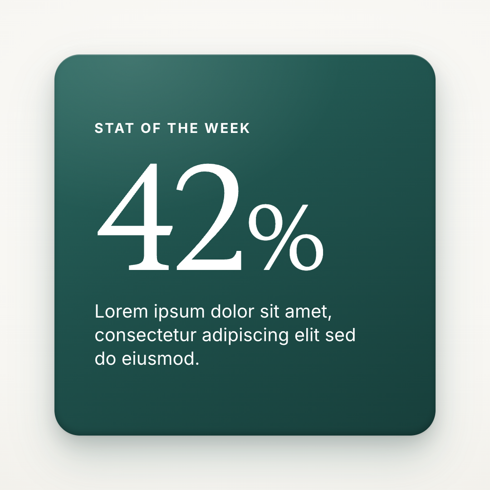
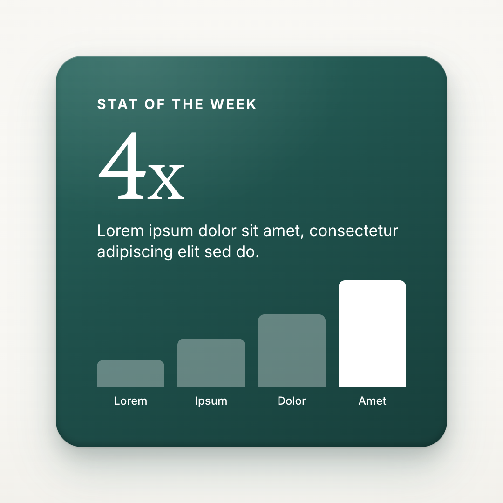
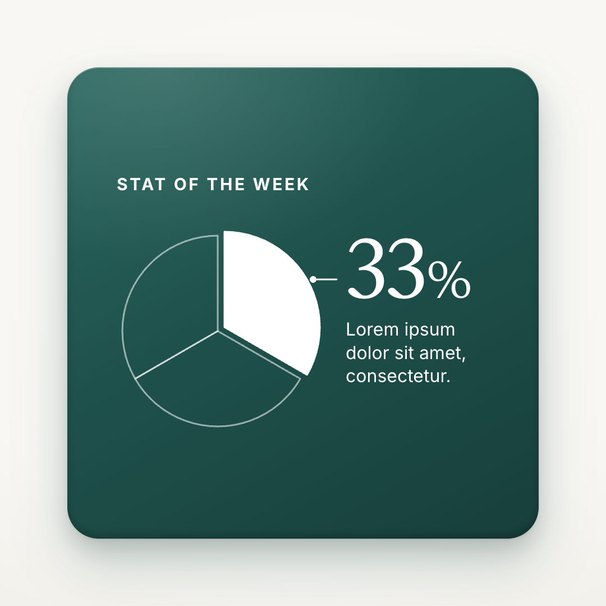

# Stat of the week templates

Reference templates for the Tuesday **stat of the week** graphic (see the `Tue` slot in [`slots.yaml`](../../slots.yaml)). There are three versions of one design. Each is a self-contained [HyperFrames](https://hyperframes.heygen.com) project that renders a 1080×1080, 8-second looping MP4.

| Template | Use when the stat is… | Reference frame |
|---|---|---|
| [`stat/`](stat/) | a single number (42%, $3.1B, 1 in 5) |  |
| [`bar-chart/`](bar-chart/) | a change across four points (4x growth, year over year) |  |
| [`pie-chart/`](pie-chart/) | a share of a whole (33% of buyers…) |  |

## How a graphic gets made

On Tuesday's pick, `graphic.py` reads the sources, chooses a template and fills it in, then renders it. Nothing is edited by hand. Each template declares its inputs as HyperFrames variables (`data-composition-variables` on `<html>`), and the machine passes them in at render time with `--variables`. The defaults are the placeholder look, so previewing a template as it stands still works.

| Variable | `stat/` | `bar-chart/` | `pie-chart/` |
|---|---|---|---|
| `eyebrow` | ✓ | ✓ | ✓ |
| `blurb` (one short line) | ✓ | ✓ | ✓ |
| `value` (the number) | ✓ | ✓ | ✓ (the share, 3 to 90) |
| `prefix` (like `$`) | ✓ | ✓ | |
| `decimals` | ✓ | ✓ | |
| `suffix` (like `%`, `x`, `B`) | ✓ | ✓ | ✓ |
| `bar_labels`, `bar_values` (3 to 5, separated by `\|`) | | ✓ | |

A long number shrinks to fit its box. In the bar chart the last bar is the highlighted one and bar sizes are relative to the biggest. In the pie chart the highlighted slice is turned so its middle always points at 60°, so the leader line never moves, and the rest of the pie is two even slices.

Before anything renders, `graphic.py` checks every number against the source text and drops the graphic if one isn't there. See the "Tuesday" section of the main README.

To make one by hand, pass variables to a copy:

```bash
cp -R templates/stat-of-the-week/stat ../videos/sotw-2026-10-06
cd ../videos/sotw-2026-10-06 && npx hyperframes render . --variables '{"value": 42, "blurb": "Of buyers plan to spend more."}' -o ./renders/video.mp4
```

## Changing a template

Edit the template itself only to change the design for every week. Keep the variables and defaults working, and keep the design rules below.

## The design rules

These are the rules the three templates share. Follow them for a new variant.

- **Canvas:** 1080×1080, 8s, seamless loop (the first and last frames are the same empty background).
- **Brand (replace with your own):** forest green `#1F514C` card with a light-to-dark gradient (`#2A675F` → `#173F3B`) for slight 3D shading. Soft white background `#F7F6F2`. All text white.
- **Type:**
  - Eyebrow: Inter Bold, all caps, `0.12em` tracking.
  - Stat: Hedvig Letters Serif.
  - Body: Inter Regular.
  - Fonts are bundled in `assets/fonts/` so renders are reproducible.
- **Timing:**

| Time | What happens |
|---|---|
| 0–1s | The card slides up and tilts flat as it lands. |
| 1–3s | The build: eyebrow, then the chart if there is one, then the stat count-up, then the blurb. |
| 3–6s | Rest on the full card. |
| 6.0–6.8s | The green expands to fill the frame. The text stays where it is. |
| 6.9–7.3s | The text fades in place. |
| 7.3–7.95s | The green fades back to white. |

- **Check:** `npx hyperframes check` passes with one known warning (`nested_structure_needs_subcomposition`). It's harmless for a single-scene piece.
